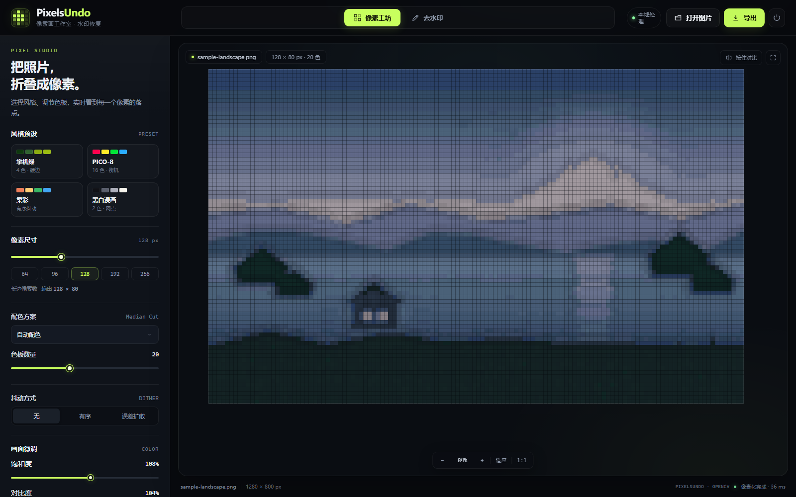
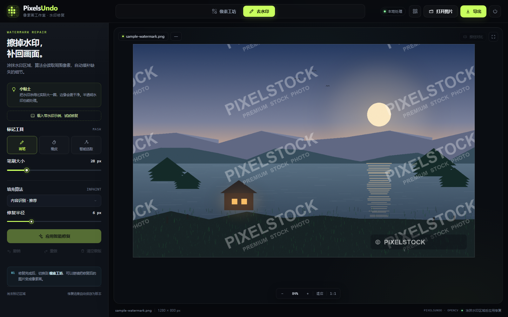
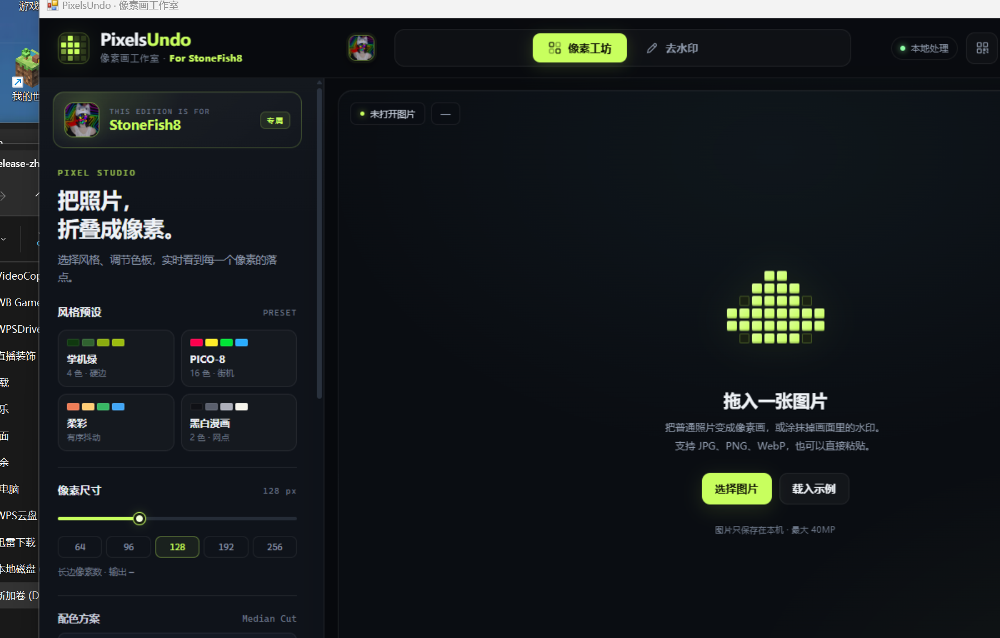
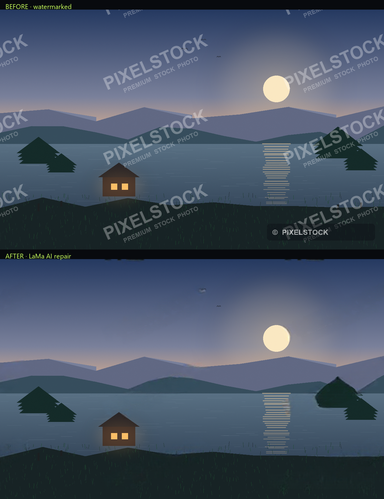
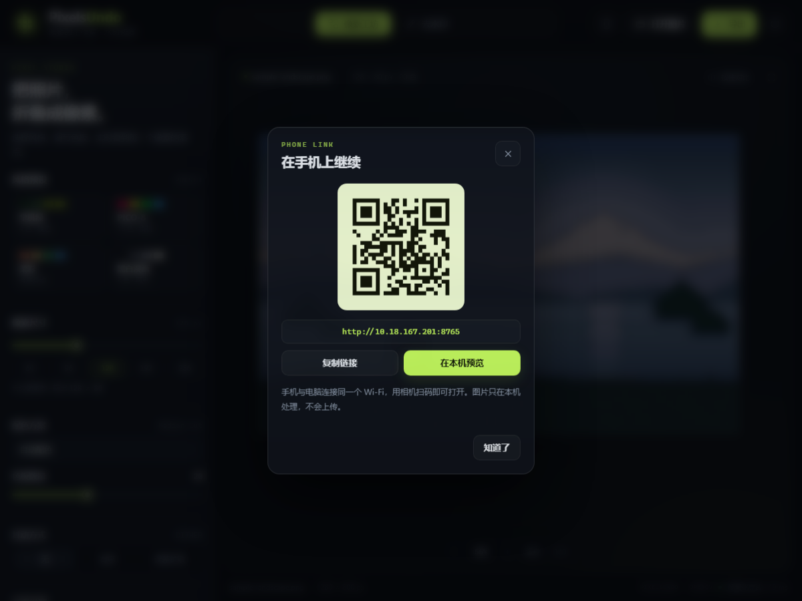
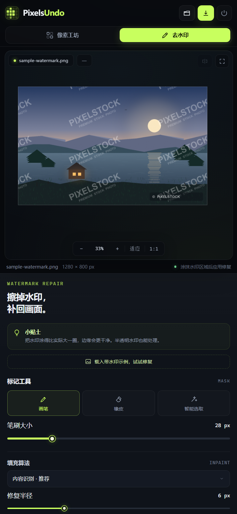

# PixelsUndo

**把照片折叠成像素，把水印擦成风景。**

**在线使用：https://pixelsundo.onrender.com** · [官网](https://ostonefisho.github.io/PixelsUndo/) · [镜像](https://cdn.jsdelivr.net/gh/OStonefishO/PixelsUndo@main/site/index.html) · [GitHub 仓库](https://github.com/OStonefishO/PixelsUndo)

PixelsUndo 是一款像素画 + 去水印小工具：一边把普通照片变成可导出的像素画，一边用画笔/智能选取 + 内容识别修复擦掉水印。它有三种用法：**在线版**打开浏览器就能用；**Windows 版**全程在本机处理；**Android App** 是对在线版的封装，导出图片会存进相册。

> **v1.4.0** · 新增 LaMa AI 修复（大面积水印最自然）、内容识别/Telea/NS 三种回退、修复半径可调、全图同色智能选取；保留独立原生窗口、Android App、在线版、色阶与检查更新。

| 像素工坊 | 去水印 |
| --- | --- |
|  |  |





### LaMa AI 修复对比

上边是半透明平铺水印原图，下边是 1.4.0 默认的 LaMa AI 修复结果。模型会按周围的山脊、云层、屋檐结构重建被遮挡的区域，而不是把整片区域抹成平均色；在线版没有 208MB 模型，仍使用轻量的内容识别回退。



---

## 直接在线使用

打开 **https://pixelsundo.onrender.com**，上传图片即可。免费实例闲置 15 分钟会休眠，第一次打开可能需要等 30–60 秒唤醒；图片只在该次会话的临时目录处理，服务重启即清空。

## 下载 Windows 版

打开 [Releases](https://github.com/OStonefishO/PixelsUndo/releases/latest)，下载 `PixelsUndo-Windows-1.4.0.zip`，解压后双击 **`启动 PixelsUndo.bat`**。它会打开一个独立的软件窗口（带标题栏，没有浏览器地址栏），不会跳到浏览器。

> 启动器会把约 1 MB 的窗口宿主复制到 `%TEMP%` 再启动，以绕开 WebView2 对中文路径的限制；`PixelsUndo-app` 数据仍留在解压目录。请保持压缩包内目录结构完整，不要只复制 exe。

> exe 没有购买代码签名证书。Windows SmartScreen 提示“已保护你的电脑”时，点“更多信息 → 仍要运行”；杀毒软件若误报，把解压目录加入信任即可。

## 下载 Android App

打开 [Releases](https://github.com/OStonefishO/PixelsUndo/releases/latest)，下载 **`PixelsUndo-Android.apk`**，在手机上允许“安装未知应用”后安装。App 需要网络，打开的是在线版；导出时会把图片直接保存到相册 `Pictures/PixelsUndo`。当前 APK 为 v1.2.0。

> APK 使用自签名调试证书，未上架应用商店；Android 可能提示“未经认证的应用”，选择继续安装即可。

## 快速开始（源码运行）

双击项目根目录下的 **`启动 PixelsUndo.bat`**。

- 首次启动会自动创建 `.venv` 并安装 Pillow、NumPy、OpenCV、Segno（约 1–3 分钟，需联网一次）。
- 源码模式仍会启动本地服务并打开浏览器（这是开发用入口）；发行版 zip 里的 `启动 PixelsUndo.bat` 才是独立窗口。
- 关闭浏览器不会退出程序；需要彻底退出时，点右上角的电源按钮 → **退出程序**。
- 如果浏览器没有自动弹出，手动访问 `http://127.0.0.1:8765`（端口被占用时程序会自动顺延）。

> 系统要求：Windows 10/11，Python 3.8–3.11。本项目已在 Windows + Python 3.8.9 (32 位) 上验证。

## 手机访问

1. 让手机和电脑连接 **同一个 Wi-Fi**。
2. 在电脑浏览器里点右上角的 **二维码图标**，弹出二维码和局域网地址。
3. 用手机相机扫码，或手动输入地址（例如 `http://192.168.1.20:8765`）。
4. iOS/Android 浏览器菜单里可以 **添加到主屏幕**，像 App 一样全屏打开。局域网是 HTTP，属于“快捷方式”；部署成 HTTPS 在线版后才会被浏览器识别为可安装 PWA。



如果手机打不开：

- 第一次使用先双击 **`允许手机访问.bat`**，在 Windows 弹出的管理员确认框里点“是”。它会为 PixelsUndo 的 Python 解释器放行 TCP 8765–8775，仅限本机局域网。
- 确认电脑和手机在同一网段，且路由器没有开启“AP 隔离/客户端隔离”。
- 公司/酒店 Wi-Fi 常会隔离设备，改用手机热点让电脑连接即可。

> 手机访问没有账号密码，同一 Wi-Fi 下的设备都能打开。请只在可信网络使用，不要在路由器上把 8765 端口映射到公网。

## 永久网址与镜像站

**完整在线版已经上线：https://pixelsundo.onrender.com**，手机和电脑都可以直接打开，也可以“添加到主屏幕”。GitHub Pages 主页负责介绍、截图和下载：

- 主站：**https://ostonefisho.github.io/PixelsUndo/**
- 镜像：**https://cdn.jsdelivr.net/gh/OStonefishO/PixelsUndo@main/site/index.html**

静态主页是永久的，镜像走 jsDelivr CDN，适合主站访问慢时使用。因为去水印依赖 Python + OpenCV，GitHub Pages **不能**运行完整应用；完整版跑在 Render 的 Docker 服务上。

### Render 有没有镜像站？

没有。Render 一个服务只有一个 `*.onrender.com` 域名，绑定自定义域名或套 CDN 仍然指向同一个服务，不是独立镜像。真正的镜像需要在另一家平台再部署一份 Python 后端；免费额度有限，两份 24 小时服务会很快耗尽 Render 的 750 小时/月。静态介绍页有 GitHub Pages + jsDelivr 两个入口，但完整后端目前只有 Render 这一份。

### 重新部署 / 自己部署

一键入口：**https://render.com/deploy?repo=https://github.com/OStonefishO/PixelsUndo**

1. 登录 [Render](https://render.com)，打开上面的 Blueprint 链接，或选择 **New → Blueprint** 连接本仓库。
2. Render 会自动读取 `render.yaml` 和 `Dockerfile`，创建一个免费 Web Service。
3. 部署完成后得到 `https://<service>.onrender.com` 的 HTTPS 地址；手机可直接打开，也可“添加到主屏幕”。
4. 建议在 Render 环境变量里设置 `PIXELSUNDO_PASSWORD`（自定义访问密码）。设置后浏览器会弹出登录框；`/api/health` 保持免密，供 Render 健康检查使用。

免费实例会在闲置后休眠，第一次打开可能需要 30–60 秒唤醒；会话数据是临时的，重启即清空。

### 镜像站（Railway / 第二个 Render 服务）

仓库里的 `railway.json` + `Dockerfile` 可直接用于 [Railway](https://railway.com)：**New Project → Deploy from GitHub repo → 选择 PixelsUndo → Generate Domain**。也可以在同一 Render 账号再建一个 Web Service 指向同一仓库，作为独立域名的镜像。

两份部署都建议设置不同的 `PIXELSUNDO_PASSWORD`。公开部署意味着任何拿到地址的人都能上传图片，请只分享给信任的人。

## 两个工作区

### 1. 像素工坊

| 控制 | 作用 |
| --- | --- |
| 风格预设 | 手机墨、PICO-8、柔彩、黑白漫画，一键切换像素尺寸/配色/抖动 |
| 像素尺寸 | 输出长边 16–512 px；越大细节越多，越小越“块” |
| 配色方案 | 自动配色（中位切分）、Game Boy、PICO-8、Sweetie 16、棕褐胶片、黑白、保留原色 |
| 色板数量 | 自动配色时的颜色数（2–64），可输入数字或点 4/8/12/16/24/32/48/64 快捷色块 |
| 抖动方式 | 无 / 有序（Bayer 4×4）/ 误差扩散（Floyd–Steinberg） |
| 饱和度 / 对比度 / 亮度 | 量化前的画面微调 |
| 色阶 | 输入黑场/白场、Gamma、输出黑场/白场五段控制；先拉色阶再量化，压暗部或提亮中间调更可控 |
| 轮廓 | 为颜色边界加一圈深色描边，像素角色感更强 |

调整会实时在服务端重新计算并回传预览；底部会显示实际输出尺寸、颜色数与耗时。

### 2. 去水印 / 修复工作室

1. 用 **画笔** 涂满水印，或用 **智能选取** 点一下水印颜色；容差可调。重复平铺的半透明水印可勾选 **全图同色**，一次选中所有相近色块。
2. 需要时用 **橡皮** 修整蒙版；`[` / `]` 调整笔刷大小。
3. 选择修复算法：
   - **AI 修复 · LaMa（最自然，约 30 秒）**：深度学习补全，最适合大面积半透明水印；需要 `models/lama_fp32.onnx`（Windows 完整包已内置，源码运行请按 `models/README.md` 下载）。\n   - **内容识别 · 更自然（较慢）**：多尺度纹理合成，从周围寻找相似的云、水纹、墙面来补洞，不需要模型，约 10–20 秒。
   - **快速扩散 · 秒出**：Telea，适合小划痕、纯色背景。
   - **平滑扩散 · 柔和**：NS，适合渐变色块。
4. **修复半径** 控制蒙版外扩与边缘羽化：值越大，边缘过渡越柔和、修复范围略大。
5. 点 **应用智能修复**。修复结果会写入版本历史，可继续涂抹、撤销/重做。
6. 修复完成后切回 **像素工坊**，把干净的图继续做成像素画。

> 说明：去水印与像素工坊在同一个独立窗口内，通过顶部的 **修复工作室 / 像素工坊** 切换，互不遮挡。

按住 **C**（或画布右上角“按住对比”）可临时查看修复前/像素化前的原图。

## 导出

- 像素画：可选 ×1 / ×2 / ×4 / ×8 最近邻放大，PNG / JPG / WebP。
- 去水印结果：导出修复后的原尺寸图片。
- 文件名支持中文；PNG 无损，JPG/WebP 可调质量。

## 检查更新

状态栏右侧显示当前版本（如 `v1.1.0`），点一下会向 GitHub Releases 查询最新版本：

- 有新版：按钮变成粉色 `更新 vX.Y.Z`，点开可看更新说明并跳转下载页。
- 无新版或仓库还没有发布 Release：显示“当前已是最新开发版”。
- 结果缓存 10 分钟；网络不可用时只提示失败，不影响本地功能。

## 快捷键

| 按键 | 功能 |
| --- | --- |
| `Ctrl + O` | 打开图片 |
| `Ctrl + S` | 打开导出窗口 |
| `Ctrl + Z` | 撤销蒙版笔触（去水印模式） |
| `B` / `E` / `W` | 画笔 / 橡皮 / 智能选取 |
| `[` / `]` | 减小 / 增大笔刷 |
| `0` | 适应窗口 |
| `空格 + 拖动` | 平移画布 |
| `C`（按住） | 查看处理前 |
| `Esc` | 关闭弹窗 |

## 目录结构

```
PixelsUndo/
├─ 启动 PixelsUndo.bat   双击启动（源码版）
├─ 允许手机访问.bat      首次手机访问时放行 Windows 防火墙
├─ PixelsUndo.exe        Release 里的免安装桌面版
├─ launcher.py           后台启动/复用服务并打开浏览器
├─ desktop.py            桌面版入口（PyInstaller 打包用）
├─ server.py             本地 HTTP 服务与 API（含局域网二维码、更新检查）
├─ requirements.txt      Windows 源码运行依赖
├─ requirements-deploy.txt  云端 Linux 部署依赖
├─ Dockerfile / render.yaml / railway.json  永久在线版部署配置
├─ pixelsundo/
│  ├─ engine.py          像素化、色阶、色板量化、抖动、描边
│  └─ inpaint.py         蒙版处理、Telea/NS 修复、智能选取
├─ web/                  界面（HTML/CSS/JS，无前端构建）
│  ├─ manifest.webmanifest  PWA 清单，可添加到手机主屏幕
│  └─ assets/            图标、头像
├─ site/                 GitHub Pages 项目主页
├─ docs/                 界面截图
├─ tools/
│  ├─ make_samples.py    重新生成示例图片
│  ├─ make_icons.py      重新生成应用图标
│  ├─ allow_lan_firewall.ps1  防火墙放行脚本
│  └─ smoke_test.py      API 全链路自检
└─ data/
   ├─ samples/           示例图片
   ├─ sessions/          临时会话与版本历史（可随时删除）
   └─ logs/              运行日志
```

## 自检与排错

服务运行时执行：

```powershell
.\.venv\Scripts\python.exe tools\smoke_test.py
```

预期输出 `12/12 PASS`。

- **端口被占用**：程序会自动尝试 8765–8794；实际地址见 `data/logs/server.log` 或 `data/runtime.json`。
- **启动没反应**：查看 `data/logs/launcher.log` 与 `data/logs/server.log`。
- **依赖安装失败**：在项目目录手动执行
  `.\.venv\Scripts\python.exe -m pip install --no-cache-dir -r requirements.txt`。
- **想清理数据**：关闭程序后删除 `data/sessions` 即可；示例图片在 `data/samples`。
- **移动项目位置**：`.venv` 内含绝对路径，移动后请删除 `.venv`，再双击启动脚本自动重建。

## 从 GitHub 获取

```powershell
git clone https://github.com/OStonefishO/PixelsUndo.git
cd PixelsUndo
.\启动 PixelsUndo.bat
```

仓库只包含源码、网页和示例图；`.venv`、会话记录与日志不会提交。

> 这是一个带 Python 图像处理后端的应用，不能直接跑在 GitHub Pages 上。永久在线版请用上面的 Render / Railway 部署配置；GitHub Pages 只承载 `site/` 介绍页。

## 隐私

所有图片仅保存在本机 `data/sessions`，不会上传到任何第三方服务。电脑端默认只监听本机；启动脚本会同时开启局域网访问，方便同一 Wi-Fi 下的手机使用。手机访问没有登录校验，退出程序后局域网入口随服务一起关闭。退出程序后可手动删除 `data/sessions` 清空记录。云端部署时请设置 `PIXELSUNDO_PASSWORD`，否则任何拿到网址的人都能使用该实例。


